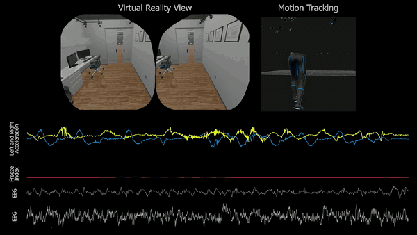
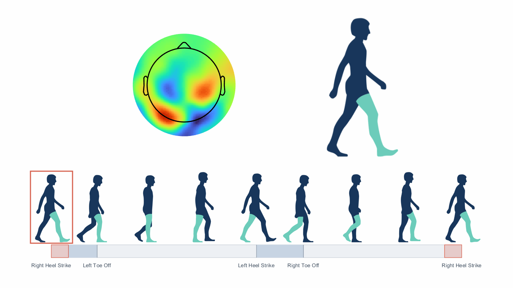

# Leo Ma, DPT, PhD

Postdoctoral scholar, UCLA · [CV](https://leima1.github.io/cv/) · [Google Scholar](https://scholar.google.com/citations?user=FOu1gisAAAAJ&hl=en) · [ResearchGate](https://www.researchgate.net/profile/Lei-Ma-22)

I study how the brain controls walking and balance. I combine intracranial and scalp brain recordings with motion capture, wearable sensors, and virtual reality to see how the brain coordinates each step, with the goal of improving mobility for people with gait deficits.

---

## Current projects

### Synchronized brain and movement recordings during real-world walking

*A freezing episode: VR view, motion capture, shank acceleration, freeze index, and simultaneous scalp + intracranial EEG.*

### Mapping cortical dynamics of gait

*Beta-band scalp topography across the gait cycle during visually cued walking in people with Parkinson's disease.*

---
